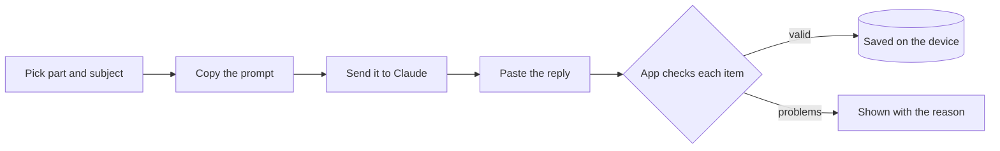

<div align="center">

<picture>
  <source media="(prefers-color-scheme: dark)" srcset="brand/logo/let-prep-horizontal-white-1200.png">
  
</picture>

<h3>Offline-first practice for the Philippine Licensure Examination for Teachers</h3>

<p>
  <a href="LICENSE"></a>
  
  
  
  
</p>

<p>
  <a href="#features">Features</a> ·
  <a href="#getting-started">Getting started</a> ·
  <a href="#accounts-and-sync-optional">Accounts and sync</a> ·
  <a href="#question-format">Question format</a> ·
  <a href="#project-structure">Project structure</a>
</p>

</div>

---

## About

LET Prep helps future teachers prepare for the **Licensure Examination for Teachers (LET)**. It keeps one question bank on your phone, offers several ways to practise, and reports progress the way the LET is actually scored.

It runs entirely in the browser, installs like an app, and works without an internet connection. An account is optional and only needed to keep your progress on more than one device.

## Features

<table>
<tr>
<td width="50%" valign="top">

**Quizzes by subject**<br>
Choose a part (General Education, Professional Education or Specialization) and a subject, then build a quiz of 10 to 150 questions.

</td>
<td width="50%" valign="top">

**Questions from Claude, with no API key**<br>
The app writes a ready-made prompt. You send it to Claude in a normal chat, paste the reply back, and the app checks every item before saving it.

</td>
</tr>
<tr>
<td valign="top">

**Mock exams in LET format**<br>
Questions are drawn in proportion to each subject's weight, on a timer that saves as you go. You can take a mock on screen, or print it on A4, Letter or Folio paper and tap in the answers afterwards.

</td>
<td valign="top">

**Stats that match the exam**<br>
See accuracy by part and subject, a projected LET rating, warnings for the 75% passing rule and the 50% floor per part, and your weakest topics.

</td>
</tr>
<tr>
<td valign="top">

**Learn from mistakes**<br>
Each session ends with the questions you missed, their correct answers and explanations. You can cross out choices while answering, edit a question whose key is wrong, and resume unfinished quizzes.

</td>
<td valign="top">

**Private and offline by default**<br>
All data stays in the browser (IndexedDB). You can export a versioned backup file and restore it on any device.

</td>
</tr>
<tr>
<td valign="top">

**Accounts and sync (optional)**<br>
With Supabase configured, you sign in with an email and password (a 6-digit email code confirms new accounts), and your bank, answers and mock exams follow you between devices.

</td>
<td valign="top">

**Accessible**<br>
It has keyboard shortcuts, real form controls, screen-reader announcements and large tap targets. Tests check every colour pair for contrast.

</td>
</tr>
</table>

### How questions get in



Generation happens in your own Claude chat, so the app needs no API key and costs nothing to run. The importer tolerates code fences and cut-off replies, and shows a preview before anything is saved.

## Tech stack

| Layer | Technology |
|---|---|
| UI | React 19, React Router 7 (hash routes), Cloudflare Kumo components, Phosphor icons |
| Language and build | TypeScript, Vite 8, `vite-plugin-pwa` |
| Local data | Dexie on IndexedDB, the source of truth |
| Accounts and sync | Supabase Auth, plus one `docs` table protected by row-level security |
| Tests | Vitest |
| Hosting | Any static host; no server code |

## Getting started

### Prerequisites

- Node.js 22 or later
- npm

### Install and run

```bash
git clone https://github.com/WWH16/LET-Reviewer.git
cd LET-Reviewer
npm install
npm run dev
```

Open http://localhost:5173. With no further setup, the app runs fully on the device. To see Stats filled in, open **Settings → Data** and load the sample answers.

### Scripts

| Command | Description |
|---|---|
| `npm run dev` | Start the development server |
| `npm run build` | Type-check and build the production bundle into `dist/` |
| `npm run preview` | Serve the production build locally |
| `npm test` | Run the test suite once |

## Accounts and sync (optional)

Without Supabase keys, the app has no sign-in and keeps everything on the device. When the keys are set, it asks users to sign in first.

1. Create a Supabase project, then run [`supabase/migrations/20261117000000_docs.sql`](supabase/migrations/20261117000000_docs.sql) in its SQL editor.
2. Copy `.env.example` to `.env.local` and fill in both values:

   | Variable | Where to find it |
   |---|---|
   | `VITE_SUPABASE_URL` | Project Settings → Data API |
   | `VITE_SUPABASE_PUBLISHABLE_KEY` | Project Settings → API Keys (starts with `sb_publishable_`) |

3. Restart the dev server.

> [!IMPORTANT]
> Use only the **publishable** key. Never put the secret key in the app or in this repository.

The full guide, with email templates, sign-in settings and production checks, is in [docs/setup-supabase.md](docs/setup-supabase.md).

## Question format

Questions are a JSON array. Each item looks like this:

```json
{
  "area": "GenEd",
  "subarea": "English",
  "topic": "Vocabulary in Context",
  "lang": "en",
  "stem": "The speaker's argument was so cogent that even her critics agreed with her. In this sentence, cogent most nearly means:",
  "choices": [
    { "key": "A", "text": "confusing" },
    { "key": "B", "text": "convincing" },
    { "key": "C", "text": "lengthy" },
    { "key": "D", "text": "emotional" }
  ],
  "answer": "B",
  "explanation": "A cogent argument is clear and persuasive.",
  "source": "ai",
  "sourceRef": "Claude GenEd set, #1",
  "status": "unverified",
  "media": null,
  "tags": []
}
```

`lang` is `en` or `fil`. The app assigns its own question IDs on import. For a full example, see [imports/general-education-30.json](imports/general-education-30.json).

## Project structure

```
src/
├── app/        App shell, routes, navigation, sign-in screen
├── domain/     Pure logic: types, LET config, validation, scoring, exam draw, prompts
├── db/         Dexie database, repository functions, backup and restore
├── ui/         Shared components and stylesheets
├── features/   Screens: study, quizzes, practice, mock exams, stats, settings
└── sync/       Supabase client, sign-in and sync
supabase/       SQL migrations
brand/          Logo masters, variants, web icons and usage guide
docs/           Product plan, design specs and audits
```

Imports go one way. `domain` imports nothing, `db` imports `domain`, and `features` imports `domain`, `db` and `ui`. Only `src/sync/` imports Supabase. Tests check these boundaries.

## Deployment

`npm run build` produces a static site in `dist/`. Hash routing means no rewrite rules are needed, so any static host works: Vercel, Netlify, Cloudflare Pages or GitHub Pages.

If you use accounts, add both `VITE_SUPABASE_*` variables to the host's environment settings before building.

> [!NOTE]
> Each device's local data belongs to the exact domain it was saved on. Choose the production domain before anyone starts using the app: a preview URL is a separate, empty app.

## Brand

The logo is an L and a P that share one stem, with a pencil shading the P's bowl like an answer bubble. Masters, one-colour versions, web icons and the usage guide are in [brand/](brand/README.md).

## Disclaimer

- **Not affiliated with the PRC.** LET Prep is not affiliated with or endorsed by the Professional Regulation Commission.
- **Ratings are estimates.** The subject weights in `src/domain/let-config.ts` are placeholders until they are checked against the official Table of Specifications. A projected rating does not guarantee an exam result.
- **Original content only.** The repository holds original sample questions only. Do not commit questions from review centres or other copyrighted sources: import them on your own device instead.

## License

Released under the [MIT License](LICENSE). © 2026 John Ansley Rocel.
